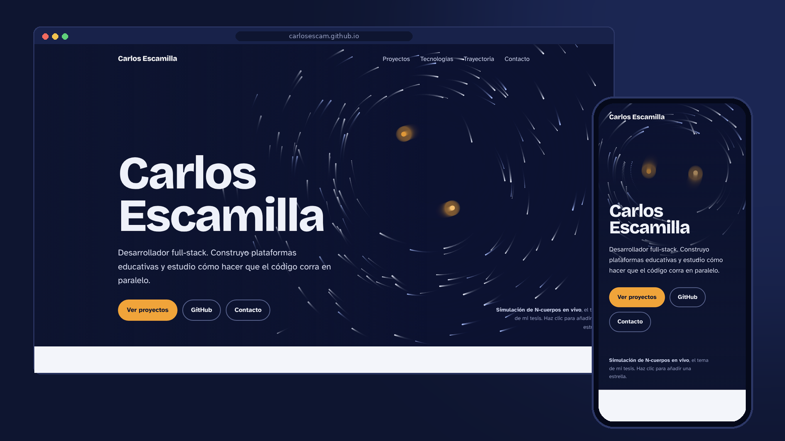
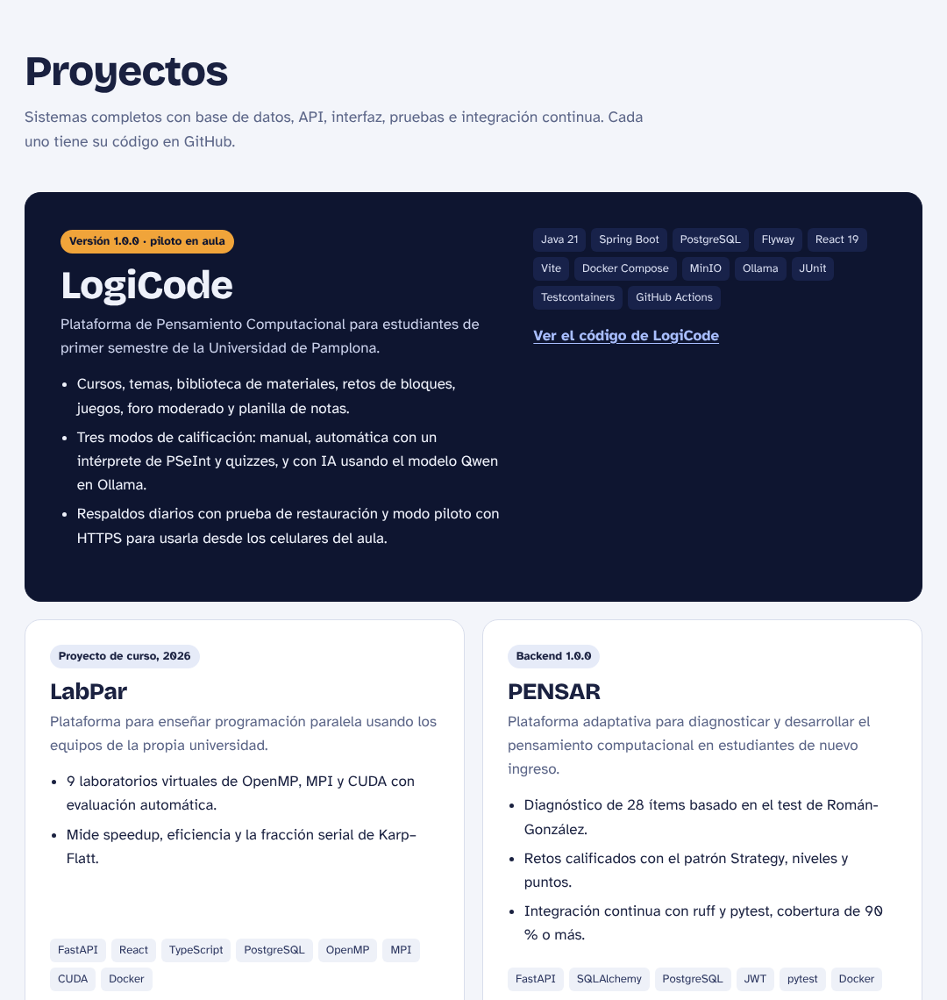
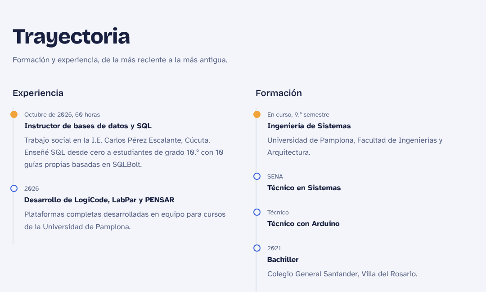

# Hola, soy Carlos Escamilla 👋

**Desarrollador Full-Stack · Backend · Plataformas educativas · Computación paralela** — Cúcuta, Colombia

Estudiante de 9.º semestre de Ingeniería de Sistemas (Universidad de Pamplona) y técnico en sistemas del SENA. Construyo plataformas completas de punta a punta: base de datos, API, interfaz, pruebas e integración continua. La mayoría de lo que hago sirve para enseñar, y en mi tesis paralelizo la simulación de N-cuerpos con OpenMP, MPI y OpenCL.

🔭 Abierto a prácticas, empleo y proyectos.

---

## 🌐 Mi portafolio

  

  

HTML, CSS y JavaScript sin frameworks · el fondo es una simulación de N-cuerpos en vivo

<table>
  <tr>
    <td width="50%"></td>
    <td width="50%"></td>
  </tr>
  <tr>
    <td align="center">Proyectos con stack, estado y enlace al código</td>
    <td align="center">Experiencia y formación</td>
  </tr>
</table>

---

## 🧩 Proyectos destacados

| Proyecto | Qué es | Stack |
| --- | --- | --- |
| [**LogiCode**](https://github.com/CarlosEscam/LogiCode-Up) `v1.0.0` | Plataforma de Pensamiento Computacional para primer semestre: cursos, retos de bloques, juegos, foro y calificación manual, automática (intérprete de PSeInt) y con IA. | Java 21, Spring Boot, PostgreSQL, React 19, Docker, Ollama |
| [**LabPar**](https://github.com/CarlosEscam/LabPar) | Plataforma para enseñar programación paralela: 9 laboratorios con evaluación automática y métricas de speedup, eficiencia y Karp–Flatt. | FastAPI, React + TypeScript, OpenMP, MPI, CUDA, Docker |
| [**PENSAR**](https://github.com/CarlosEscam/pensar-platform) `v1.0.0` | Diagnóstico y desarrollo del pensamiento computacional: test de 28 ítems (Román-González), retos con patrón Strategy y gamificación. | FastAPI, SQLAlchemy, PostgreSQL, pytest (≥ 90 %), Docker |
| [**LogiCode (Node.js)**](https://github.com/CarlosEscam/LogiCode) | Implementación de LogiCode con roles, actividades autocalificadas, juegos y foro público. | Express, Prisma, PostgreSQL, Next.js, Tailwind |
| **Riesgo de deserción** | App que compara K-means, DBSCAN, GMM y clustering jerárquico para perfilar el riesgo de deserción universitaria en Cúcuta. | Python, Streamlit |
| **N-cuerpos en paralelo** *(tesis)* | El mismo algoritmo con OpenMP, MPI y OpenCL sobre GPU Radeon, con análisis de speedup y escalabilidad. | C/C++, OpenMP, MPI, OpenCL |

## 🛠️ Tecnologías

  

## 🗂️ Actualmente trabajando en...

- Llevar **LogiCode** al piloto en aula con el docente (diciembre de 2026)
- El anteproyecto de tesis: **N-cuerpos con OpenMP, MPI y OpenCL**
- La interfaz React y el panel docente de **PENSAR**

## 📫 Contacto

¿Tienes un proyecto, una práctica o una vacante en backend, plataformas educativas o computación paralela? Escríbeme a **carlosescamilla2023@gmail.com**.
